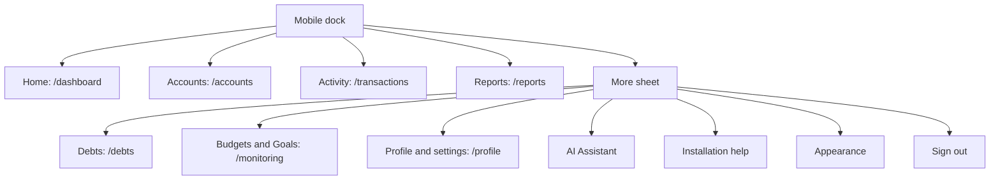

# Mobile UX and iOS PWA Audit

Audit date: 2026-10-23. Target: PennyWings in iPhone Safari and as an installed Home Screen web app.

## Summary and agreed direction

PennyWings already has a standalone manifest, mobile safe-area handling, a persistent signed-in shell, responsive screens, and shared overlay controls. The highest-value improvements are navigation clarity, route continuity, and a useful offline launch experience.

The findings below record the original audit baseline. Implementation followed the audit, then the user revised the visual scope after reviewing screenshots: restore the previous page design, remove horizontal scrolling from account and transaction controls, retain the new navbar and connection behavior, and use bottom sheets for both transaction and account creation. The status table below takes precedence over the original proposals.

The agreed direction is:

- Use five labeled dock controls: **Home, Accounts, Activity, Reports, More**.
- Keep the More sheet. Move Debts and Monitoring into it, alongside existing profile, assistant, appearance, and sign-out access.
- Preserve the pink palette, Geist typography, existing financial behavior, and desktop sidebar.
- Keep the original page headers, primary actions, surfaces, and responsive grids. Account tabs and transaction filters wrap; they do not require horizontal scrolling. Sticky toolbars and compact page restyling were withdrawn by the user.
- Present New/Edit Transaction and account creation as bottom sheets on phones, opening from the bottom edge with rounded top corners, scrollable fields, and reachable actions. Account creation sizes to its content instead of occupying the entire screen. Other short account, debt, budget, and goal forms use the same shared presentation.
- Support an offline launch/reconnect screen. Financial reads and writes require a connection; offline financial caching and queued writes are outside this release.

Success means users can identify destinations, resume their place after navigation or authentication, retain usable form actions, and reopen the installed app without encountering an unexplained network failure.

## Implementation status after screenshot feedback

| Area | Status |
| --- | --- |
| Five labeled destinations and More | Implemented; the user explicitly retained the new navbar. Desktop sidebar unchanged. |
| Original page design and wrapping controls | Restored. Horizontal account summary/tab strips and transaction filter strips were removed, not merely hidden. |
| Transaction and account creation sheets | Implemented; both attach to the viewport bottom. Account creation is content-height. Nested payment pickers retain draft state and shared focus/scroll locking. |
| SweetAlert2 placement | All shared confirmations use mobile bottom sheets; success/error/warning/info notifications sit above the mobile navbar. Desktop placement is preserved. Chromium/WebKit checks covered 320/440px portrait, short landscape, cancel behavior, and desktop centering. Alert scroll-lock unit checks passed. |
| Connection and offline saves | Implemented; drafts remain mounted during connection loss. Writes reject immediately without replay. Structured Supabase transport failures require refreshed records before another attempt. |
| Auth and route continuity | Implemented; safe one-use destinations, preserved query/history state, removed artificial delay, tab/history scroll memory, report month URLs, and sign-out/user-switch isolation. |
| PWA runtime and installation help | Implemented; production-only worker, public reconnect fallback, static-only cache, normal update activation, and Safari installation instructions in More. |
| Compact sticky headers, new summary/card layouts, larger calendar selector | Withdrawn with the visual redesign. The prior page design is preserved. |
| Actual installed iPhone acceptance | Pending physical-device validation. Browser emulation does not validate installation, VoiceOver, real keyboard geometry, or Safari-to-app OAuth handoff. |

Independent review found and verified fixes for transport-error classification and sign-out return-target isolation. The sticky-toolbar finding became irrelevant when the page redesign was withdrawn.

### Implementation verification

- `npm run lint`: passed with three existing React Hook Form compiler warnings in debt forms.
- `npm run build`: passed. Vite reports a main chunk above 500 kB; no dependency was added.
- `npm run test`: 48 files, 409 tests passed.
- Focused Mobile Safari navigation/PWA/route checks: 20 passed, one skipped because that fixture lacked enough scrollable content.
- Mobile Safari form, focus, auth, primary-action, and revised-design checks: 54 passed. This includes wrapping controls at 320/390/440px and content-height account creation.
- Production preview worker checks: Chromium and WebKit passed. Verified connection-failure fallback, original-URL retry, cache contents limited to `/offline.html`, and normal HTTP 503 responses remaining distinct from offline failures.
- Mock-data visual inspection at 440?956 confirmed restored page styling, the retained five-control navbar, and bottom-attached transaction/account sheets. No personal financial data was used for validation.
- WebKit modal scroll-lock and revised mobile flow checks: 19 passed. Mouse-wheel checks use the desktop WebKit context at the required viewport sizes because mobile WebKit does not implement Playwright mouse-wheel input. The separate Mobile Safari tab/Back/reselect scroll-restoration regression also passed.

Worker validation uses a local origin connection failure because [Playwright WebKit offline emulation rejects worker-supplied navigations](https://github.com/microsoft/playwright/issues/42775). Installation copy follows [Apple?s Safari Home Screen instructions](https://support.apple.com/en-lamr/guide/iphone/iphea86e5236/ios); mutation behavior follows [TanStack Query network modes](https://tanstack.com/query/latest/docs/framework/react/guides/network-mode).

## Method, coverage, and evidence limits

The review covered frontend routes, their page and section components, relevant hooks and services, shared navigation, forms, overlays, CSS, manifest, bootstrap/build/deployment configuration, and existing unit and browser checks. Backend inspection was limited to understanding frontend flow constraints; this is not a database or security audit.

UI/UX Pro Max informed touch, accessibility, keyboard, focus, and navigation checks. The navigation searches did not return a verified match for the five-control limit; that recommendation uses the skill's built-in navigation rules and the agreed product choice. GPT Taste informed hierarchy, spacing, contrast, and visual consistency. The approved identity takes precedence over its cinematic landing-page patterns: authenticated financial screens should retain compact, task-focused layouts. Use existing Motion/CSS capabilities rather than adding GSAP for this work. Superpowers brainstorming established the choices above and the roadmap below.

Evidence classifications:

- **Confirmed behavior:** established by current source or an executed check.
- **Design improvement:** an intentional change to current behavior, not a claimed runtime defect.
- **Device risk:** a plausible issue requiring measurement or real iPhone verification.

Priorities indicate importance to this mobile release, not security severity. **P1** is core navigation or launch work; **P2** is continuity, polish, or verification. Effort is relative: **S** is a localized change, **M** spans shared behavior and callers, and **L** spans multiple lifecycle boundaries and device validation. These are not time estimates.

| Area reviewed | Existing behavior and audit focus | Evidence |
| --- | --- | --- |
| Landing and legal | Public entry, responsive navigation, content, and reduced-motion expectations; preserve the existing identity rather than redesigning marketing pages | [Home](src/pages/Home.tsx), [landing navigation](src/sections/home/LandingNav.tsx), [terms](src/pages/TermsAndConditions.tsx) |
| Authentication | Password login, registration aliases, recovery, Google login, and protected-route entry; intended-destination continuity is missing | [route map](src/App.tsx#L43), [login](src/pages/auth/Login.tsx#L49), [auth service](src/services/authService.ts#L57) |
| Dashboard | Summary hierarchy, cards, daily-spending calendar, and long-page navigation; narrow calendar targets need measurement | [dashboard](src/pages/Dashboard.tsx), [calendar](src/sections/shared/DailySpendingCalendarSection.tsx#L356) |
| Accounts | URL-backed tabs, local search, account creation, editing, sharing/joining, and empty states; retain existing access and money semantics | [accounts](src/pages/Accounts.tsx#L94), [creation wizard](src/sections/accounts/AccountCreationWizard.tsx), [sharing](src/sections/accounts/ShareAccountModal.tsx) |
| Activity | URL-backed type/search/page state, responsive ledger cards, transaction composer, and payment-source selection | [transactions](src/pages/Transactions.tsx#L36), [responsive ledger](src/sections/transactions/TransactionsTable.tsx#L187), [form](src/sections/transactions/TransactionForm.tsx) |
| Debts | List, charges, repayment, history, and header action; keep repayment behavior unchanged | [debts](src/pages/Debts.tsx), [header action](src/sections/debts/DebtsHeader.tsx#L11), [payment form](src/sections/debts/PayDebtModal.tsx) |
| Monitoring | URL-backed budget/goal tabs, create/edit forms, and contextual header action | [monitoring](src/pages/Monitoring.tsx#L32), [header](src/sections/monitoring/MonitoringHeader.tsx#L11) |
| Reports | Month selection, cash flow, category allocation, account snapshots, and empty reports; month state resets on remount | [reports](src/pages/Reports.tsx#L23), [report sections](src/sections/reports) |
| Profile | General/security/danger views and deletion reauthentication; preserve recovery and destructive-action safeguards | [profile](src/pages/Profile.tsx#L13), [danger section](src/sections/profile/DangerSection.tsx) |
| Assistant | Mobile dialog ownership, composer, conversation scrolling, keyboard interaction, and handoff from More | [widget](src/sections/assistant/AssistantWidget.tsx), [composer](src/sections/assistant/AssistantComposer.tsx) |
| Shared infrastructure | Persistent shell, scroll/focus ownership, viewport, safe areas, theme, prefetching, and PWA/browser coverage | [shell](src/components/AppShell.tsx), [modal frame](src/components/ui/ModalFrame.tsx), [styles](src/index.css), [browser configuration](playwright.config.ts) |

This is a source-based review across frontend domains, not a claim that every repository line or every screen was exercised. No visual contrast measurements, performance benchmark, live financial-data inspection, or installed-device pass was performed.

## Current routes and proposed mobile navigation

The canonical route declarations are in [App.tsx](src/App.tsx#L43).

| Access | Routes | Current mobile entry |
| --- | --- | --- |
| Public | `/`, `/login`, `/signup`, `/register`, `/forgot-password`, `/terms-and-conditions` | Landing/auth links; both registration URLs render registration |
| Recovery | `/reset-password` | Recovery link; separate from the public-only route guard |
| Protected primary | `/dashboard`, `/accounts`, `/transactions`, `/reports` | Current dock links |
| Protected secondary | `/debts`, `/monitoring`, `/profile` | Debts and Monitoring are dock links; Profile is in More |
| Unmatched | `*` | Not-found page |

The current dock exposes Home, Accounts, Activity, Reports, Debts, Monitor, and More. Its six destination links have accessible names but no visible labels. The proposed map retains every URL and changes mobile entry points only:

More remains a dialog rather than a new `/more` route. Opening it is an action, not a page navigation. Give it a visual current-section state on secondary routes; keep `aria-expanded` tied to whether the sheet is open. Mark the current destination link inside the sheet with `aria-current="page"`. Closing the sheet must restore focus and scroll without adding artificial browser-history entries.

## Prioritized findings

### P1-01: Simplify and label mobile navigation

**Classification:** Design improvement. **Effort:** M.

**Evidence:** [MobileNavigation.tsx:27](src/components/ui/MobileNavigation.tsx#L27) defines six destinations, followed by More. [The dock CSS](src/index.css#L325) uses seven columns. [Existing tests](tests/e2e/mobileNavigation.spec.ts#L16) explicitly require seven controls and zero visible labels. The code already aims to maintain 44-pixel targets; this finding does not claim the dock currently violates that minimum.

**Impact:** Users must recognize six destination icons, while seven controls occupy the narrowest phone widths. The Profile route has no selected primary destination because the active index only covers those six links.

**Target behavior:** Show Home, Accounts, Activity, Reports, and More with persistent visible labels. Keep the active indicator, route prefetching, fixed dock size, and current breakpoint. Add labeled Debts and Budgets & Goals links to More. Show More as the current section for Debts, Monitoring, and Profile, without treating the button itself as a page link.

**Acceptance:** Exactly five dock controls at all mobile widths; each target is at least 44 by 44 CSS pixels; labels fit at enlarged text sizes; secondary routes remain reachable and identifiable. Existing More actions, keyboard hiding, dialog focus, Escape/backdrop dismissal, and desktop handoff still work.

### P1-02: Resume the intended destination after authentication

**Classification:** Confirmed flow gap. **Effort:** M.

**Evidence:** [ProtectedRoute.tsx:24](src/components/ProtectedRoute.tsx#L24) redirects to login without preserving the target. [Login.tsx:49](src/pages/auth/Login.tsx#L49) and [PublicRoute.tsx:27](src/components/PublicRoute.tsx#L27) send signed-in users to Dashboard. [Google login](src/services/authService.ts#L57) also uses a Dashboard redirect.

**Impact:** Opening a signed-out protected link such as `/reports?month=2026-09` loses the requested context after login. A manifest start URL alone does not solve this.

**Target behavior:** Use one consistent return-destination policy across the guard, password login, public guard, and Google login. Preserve a validated internal pathname, query, and fragment; default to `/dashboard`. Persist only the pending internal destination for the OAuth round trip, consume it once, and clear it on cancellation/sign-out. Reject external and malformed return targets. Never store authentication callback credentials in the pending destination.

**Acceptance:** A signed-out Accounts or Reports deep link resumes after password login and Google login. Normal login still opens Dashboard. Password recovery and the separate Google deletion reauthentication path continue to use their intended destinations. Installed-app OAuth handoff must be verified on an iPhone; source review cannot guarantee the OS will reopen the standalone window.

### P1-03: Provide an offline navigation fallback

**Classification:** Confirmed capability gap against the selected offline requirement. **Effort:** M.

**Evidence:** [The manifest](public/manifest.webmanifest) defines standalone display and `/dashboard` as the start URL. Review of [bootstrap](src/main.tsx), [Vite configuration](vite.config.ts), and public assets found no service-worker registration or offline worker. [PWA tests](tests/e2e/pwa.spec.ts) cover metadata and simulated layout, not offline navigation.

**Impact:** The site has no application-managed fallback for a network-unavailable cold launch. Installation and offline reliability are separate capabilities: iOS Home Screen web apps do not require a service worker for installation. See [WebKit's explanation](https://webkit.org/blog/17333/webkit-features-in-safari-26-0/).

**Target behavior:** Add a small dependency-free worker and a self-contained branded offline page. After one successful online visit and worker activation, same-origin app document navigations should fall back to that page on a network failure. Cache only an explicit static allowlist needed for the fallback, not protected HTML, API responses, avatars, financial data, or authentication callbacks. A server error must not be misrepresented as a confirmed offline state.

The fallback should explain that a connection is required and provide Retry for the originally requested internal URL. An already-open app should show connection feedback, preserve unsent form input in memory, and refuse new financial submissions while offline rather than queueing them for later. Handle request failures as well as connectivity events; `navigator.onLine` alone does not prove the backend is reachable. Reconnection must not automatically replay a financial mutation.

**Acceptance:** A previously visited, worker-controlled app opens a useful offline screen in airplane mode and returns to the requested route after reconnecting. No authenticated response appears in worker caches. Failed or offline submissions create no later transaction. Updates never force-reload unfinished forms; activate a waiting release on a clean subsequent launch or explicit safe reload. Verify worker/offline asset serving against the built preview and deployment rewrites, not only the Vite development server. Offline support before the first successful visit, or after browser storage eviction, is not promised.

### P2-01: Restore navigation context instead of resetting every page visit

**Classification:** Design improvement to confirmed behavior. **Effort:** L.

**Evidence:** [RouteTransition.tsx:19](src/components/RouteTransition.tsx#L19) scrolls to the top on every pathname change. [Existing transition coverage](tests/e2e/routeTransition.spec.ts) verifies that a newly opened destination starts at the top. [Transactions](src/pages/Transactions.tsx#L36), [Accounts](src/pages/Accounts.tsx#L94), and [Monitoring](src/pages/Monitoring.tsx#L32) already use URL-backed navigation state.

**Impact:** Back navigation and revisiting a tab can require users to find their place again. The current reset is deliberate behavior, not evidence of a browser crash or broken route.

**Target behavior:** Restore scroll for back/forward history entries and remember the last URL/scroll for each primary tab during the signed-in session. First visits start at the top. Returning to a tab restores its last query context; reselecting the active tab scrolls to the top without clearing filters. Restore after the destination's content is ready. Keep state in memory, scoped to the signed-in user, and clear it on sign-out. Query changes that alter the result set should not restore an unrelated list offset.

**Acceptance:** Browse and scroll filtered Activity, visit Accounts, and return without losing the filter or place. Browser back/forward restores the corresponding entry; a first visit still starts at the top. No shell remount, duplicate landmark, scroll flash during loading, cross-user restoration, or override of an explicit fragment target occurs.

### P2-02: Keep one page action reachable after scrolling

**Classification:** Design improvement. **Effort:** M.

**Evidence:** New Transaction and Add Account are in [Activity's header](src/pages/Transactions.tsx#L182) and [Accounts' header](src/pages/Accounts.tsx#L347). [Debts](src/sections/debts/DebtsHeader.tsx#L11) and [Monitoring](src/sections/monitoring/MonitoringHeader.tsx#L11) use similar header actions. [Current action tests](tests/e2e/mobilePrimaryAction.spec.ts#L23) explicitly prohibit a separate contextual floating control.

**Impact:** Creation actions become unavailable in the viewport after a long scroll. Adding another floating button would duplicate the existing action and compete with the dock.

**Target behavior:** On mobile, place the existing title/action row in one compact sticky top toolbar for Activity, Accounts, Debts, and Monitoring. Let descriptions scroll normally. The action remains contextual: New Transaction, Add account, Add Debt, or New budget/New goal according to the selected view. Do not invent a creation action for Dashboard, Reports, or Profile. Hide the sticky presentation while the keyboard or a modal owns the screen, preserving a stable layout. Keep one page heading and one actionable creation control.

**Acceptance:** Each action remains reachable after scrolling and opens the existing form. Toolbar and focused fields clear the notch and visible viewport; no content or dialog close control is covered. Desktop header layout stays intact. Switching Monitoring tabs updates the action, and dock navigation never opens a form automatically.

### P2-03: Preserve the selected report month in the URL

**Classification:** Confirmed state-retention opportunity. **Effort:** S.

**Evidence:** [Reports.tsx:23](src/pages/Reports.tsx#L23) initializes `selectedMonth` to the current month in component state.

**Impact:** Reloading or remounting Reports forgets the selected month, unlike the URL-backed tabs and filters elsewhere.

**Target behavior:** Use `/reports?month=YYYY-MM`. Reuse existing report-month helpers; accept a valid calendar month and default missing/invalid input to the current month. A user-selected month creates a history entry, while invalid-value normalization replaces the current entry. Preserve unrelated query parameters. This changes presentation state only, not reporting timezone or aggregation rules.

**Acceptance:** Selection survives refresh, links, tab return, and back/forward. Invalid month values do not crash or create invalid dates. Existing report totals and empty-month behavior remain unchanged.

### P2-04: Make installation discoverable without implying automatic installation

**Classification:** Design improvement. **Effort:** S.

**Evidence:** [index.html:6](index.html#L6) already includes Apple icon metadata, standalone metadata, viewport coverage, and theme colors. The current [More sheet](src/components/ui/MobileNavigation.tsx) has no installation-help entry.

**Target behavior:** Add dismissible installation help in More for signed-in Safari users. Explain Safari's Share menu, Add to Home Screen, and enabling Open as Web App when that option is shown. Keep instructions version-aware through reviewed copy rather than promising one fixed browser-toolbar layout. Hide installation guidance when already standalone; it is manual help, not a simulated native installation prompt. See [Apple's installation guide](https://support.apple.com/en-lamr/guide/iphone/iphea86e5236/ios).

**Acceptance:** A signed-in Safari user can find the instructions in More without an interrupting prompt. A signed-out visitor reaches this help after signing in; this phase does not add a public installation entry point. The installed app shows no redundant installation action. Verify the resulting icon, standalone launch, signed-out start, theme/status area, and relaunch from the app switcher on hardware.

### P2-05: Measure calendar touch targets and provide a larger selection path

**Classification:** Device/layout risk, not a reproduced failure. **Effort:** M.

**Evidence:** [Calendar layout comments](src/sections/shared/DailySpendingCalendarSection.tsx#L356) account for narrow seven-column cells. [Day buttons](src/sections/shared/DailySpendingCalendarSection.tsx#L380) have a minimum height without a corresponding minimum width. This suggests a narrow-target concern but is not a measured violation.

**Target behavior:** Measure day hit areas at 320 and 375 pixels. Preserve the compact calendar visualization and provide a labeled selected-day control with Previous day/Next day actions at least 44 by 44 pixels. Expose the selected day's full amount and detail without relying on compact text or color alone. Keep existing financial totals and calendar date semantics.

**Acceptance:** A user can select any day and open its detail through comfortably sized controls without horizontal page scrolling. Test empty days, large amounts, month transitions, keyboard selection, and VoiceOver announcements.

### P2-06: Expand Safari verification beyond metadata and simulated layout

**Classification:** Confirmed verification gap. **Effort:** M, plus device access.

**Evidence:** [Mobile Safari configuration](playwright.config.ts#L34) uses an iPhone 13 WebKit profile and a restricted test filename pattern. It includes several design and mobile suites but excludes dedicated auth, route-transition, debts, modal-focus, and modal-scroll filenames. [The standalone layout check](tests/e2e/pwa.spec.ts#L51) activates CSS rules programmatically; it does not install a web app. Some Reports/Profile/Monitoring behavior is covered by broader design suites, so these areas should not be described as completely untested.

**Target behavior:** Include focused route/auth/overlay flows in the Mobile Safari project and add production-preview checks for worker lifecycle and offline fallback. Keep simulation checks, but label their limits. Record hardware model, iOS version, browser/standalone mode, and result for each real-device scenario.

**Acceptance:** No installation, keyboard, safe-area, OAuth-handoff, or touch-feel claim is marked verified solely from desktop browser emulation. Resolve the local missing WebKit executable before running browser assertions; installing dependencies or tooling remains a separate authorized action.

### P2-07: Present transaction forms as mobile bottom sheets

**Classification:** Requested mobile interaction improvement. **Effort:** M.

**Evidence:** [TransactionForm.tsx:286](src/sections/transactions/TransactionForm.tsx#L286) renders the shared ModalFrame for creation and editing. [ModalFrame](src/components/ui/ModalFrame.tsx#L167) uses the shared overlay geometry, whose [CSS](src/index.css#L90) centers the panel vertically. The current form therefore does not specify a bottom-attached mobile presentation. Its existing action slot already provides a useful foundation for keeping Save separate from the scrolling fields.

**Target behavior:** Below the existing 768-pixel mobile breakpoint, New Transaction and Edit Transaction should open as full-width bottom sheets attached to the bottom of the visible viewport. Use rounded top corners, the existing pink/Geist surfaces, a dimmed backdrop, and a short upward entrance with reduced-motion support. Size the sheet to its content up to the available viewport height, retaining top safe-area clearance; long forms can fill most of the screen rather than being squeezed into a small panel. Desktop presentation remains the existing centered dialog.

Keep the title and close control visible and the primary Save/Update action in the sheet footer when viewport height permits. Scroll the form body independently and pad the footer for the home indicator. When the keyboard opens, keep the active field and submit action reachable within the visible viewport. On very short or landscape viewports, retain the existing single-scroller fallback rather than allowing fixed header/footer regions to consume the form. The page and dock behind the sheet must remain inert and must not scroll.

Add an opt-in mobile-sheet presentation to the shared modal rather than globally moving every modal to the bottom. Apply it to the transaction composer first. Preserve current validation, transaction-type and fee behavior, save/close-disabled handling, focus restoration, and unsaved field values when the payment-source picker opens and returns. Retain explicit close, backdrop, and keyboard dismissal behavior; draggable detents and swipe-to-dismiss are not part of the first version.

**Acceptance:** New and Edit Transaction open from the bottom at 320, 375, 390, and 430-pixel widths and remain centered on desktop. Test expense, income, transfer, withdrawal, fee fields, validation errors, saving, and failed submission. The last field, footer action, and close control remain reachable with the iPhone keyboard visible and in short landscape layouts. Opening and closing payment-source selection preserves the form, closing the sheet restores Activity's scroll/focus, and reduced motion removes the entrance animation. Verify bottom attachment, keyboard resizing, and home-indicator clearance in both Safari and the installed iPhone app; emulation is insufficient for the final device gate.

## Existing strengths and cross-screen polish

Preserve these foundations rather than replacing them during the redesign:

- [AppShell](src/components/AppShell.tsx) keeps signed-in chrome mounted across route changes, with route-level loading inside it.
- [Route prefetching](src/lib/routePrefetch.ts) shares lazy imports with route definitions.
- [Field styles](src/components/ui/fieldStyles.ts#L19) use base-size input text; [the assistant composer](src/sections/assistant/AssistantComposer.tsx) also uses base text. Verify actual iOS focus behavior rather than disabling page zoom.
- [Mobile keyboard detection](src/hooks/useMobileKeyboard.ts) accounts for viewport changes and pinch zoom; [navigation](src/components/ui/MobileNavigation.tsx) hides during keyboard entry.
- [ModalFrame](src/components/ui/ModalFrame.tsx) centralizes focus, scroll ownership, overlay ordering, and close-disabled saving behavior. Keep modal actions reachable instead of introducing competing overlay implementations.
- [Mobile CSS](src/index.css#L291) reserves dock space and safe-area insets, with standalone adjustments and reduced-motion rules. Keep those protections when dock height changes to accommodate labels.
- [The transaction ledger](src/sections/transactions/TransactionsTable.tsx) already switches to a card presentation at narrow container widths.

Use the following as targeted acceptance work, not as unsupported claims that every screen is broken:

| Flow | Mobile polish to verify |
| --- | --- |
| First use | Registration, account creation, first transaction, and empty Dashboard/Reports states should explain the next useful action without adding a new onboarding wizard |
| Money forms | Check decimal keyboards, visible labels, inline errors, saving feedback, failed requests, and prevention of duplicate submission; retain existing validation and database-owned balances |
| Accounts and debts | Exercise long names, zero balances, large figures, shared access, repayment sources, and long edit/history dialogs without overflow or clipped actions |
| Reports and monitoring | Read charts without color alone; expose full figures, readable legends, selected period/tab, and helpful empty/retry states |
| Profile and assistant | Verify long profile data, confirmation dialogs, stacked overlays, message growth, focus restoration, and keyboard-visible composer controls |
| All screens | Verify text contrast, press/focus feedback, enlarged text, both themes, reduced motion, and no horizontal page overflow; gate hover effects by capability |
| Performance | Measure cold/warm route loads, layout shifts, chart work, and image sizes using build output and browser profiling before proposing a regression fix; no performance problem was measured in this audit |

Normal text should meet 4.5:1 contrast and meaningful controls/icons 3:1 against adjacent colors. Keep touch targets at least 44 by 44 CSS pixels where possible, input text at least 16 pixels on phones, and pinch zoom available. These are acceptance targets; this audit did not measure all composed colors or hit areas.

## Ordered implementation backlog

Each phase should be reviewable and validated before the next phase. Checkboxes track future application work, not completion of this document.

| Phase | Work and interfaces | Completion gate |
| --- | --- | --- |
| 1 | P1-01: five labeled controls and expanded More sheet; retain all route URLs and current navigation callback responsibilities | Navigation, focus, active-section, keyboard hiding, safe-area, desktop, and enlarged-text checks pass; tests no longer require seven controls or icon-only presentation |
| 2 | P1-02, P2-01, P2-03: shared internal return-destination policy, session-scoped scroll/tab restoration, and Reports `month` query parameter | Password/OAuth destinations, fresh entry, back/forward, tab return, fragment targets, report-month history, and sign-out cleanup pass |
| 3 | P2-07, revised scope: shared mobile bottom sheets including New/Edit Transaction and content-height account creation; retain prior page styling and wrapping controls | One actionable creation control per relevant page, bottom-attached transaction sheets with reachable fields/save actions, no overlay/keyboard collision, unchanged financial results, and accessible calendar navigation |
| 4 | P1-03, P2-04: worker registration, static offline fallback, connection/submission safeguards, and installation help | Built preview serves correct worker/fallback content; offline launch/reconnect, no financial caching/queued writes, and safe update lifecycle pass |
| 5 | P2-06: broaden Mobile Safari flow coverage and complete hardware acceptance | Record real iPhone results and exact versions; distinguish blocked scenarios from passes |

Public application URLs remain unchanged. The only planned URL contract addition is Reports' optional `month` parameter. Authentication helpers and shared frontend components may gain internal inputs for the approved behavior, but no database schema, RPC contract, generated type, financial calculation, or dependency change is required by this roadmap.

Keep database access in services behind hooks. Do not use frontend balance arithmetic, new mutation retry behavior, or optimistic financial writes to make the UI feel faster. Preserve checked atomic operations, ownership, shared access, precision, transfer/reporting boundaries, and existing query invalidation.

## Verification record and acceptance matrix

### Checks executed during audit planning

These results predate creation of this document and are recorded as the planning baseline, not as checks of the proposed application changes.

| Command | Result |
| --- | --- |
| `rtk npm run test -- tests/unit/AppShell.test.tsx tests/unit/useMobileKeyboard.test.tsx tests/unit/themeColor.test.ts` | Passed: 3 files, 9 tests |
| `rtk npx playwright test tests/e2e/mobileNavigation.spec.ts tests/e2e/pwa.spec.ts --project='Mobile Safari' --workers=1 --reporter=line --grep='serves a standalone\|signed-out standalone\|stays a fixed size'` | 1 request-based manifest/icon check passed; 2 browser checks failed before assertions because the local WebKit executable was missing |
| Real iPhone Safari and installed Home Screen application | Not run; no hardware session was available |

The missing executable was Playwright's `webkit-2336/Playwright.exe`. It is an environment blocker, not evidence that the navigation assertions failed. No browser download or dependency installation was performed to bypass it.

The current `package.json` includes Vitest and Playwright scripts. Use that source of truth rather than repeating older documentation that says no automated test script exists. Lint and build are separate checks, not tests.

### Checks for subsequent source changes

Run `npm run lint`, `npm run build`, relevant `npm run test -- <files>` selections, and focused `npm run test:e2e -- <specs> --project="Mobile Safari"` coverage. Update legacy assertions in the mobile navigation, primary-action, and route-transition suites to the approved behavior. Exercise both mobile and desktop navigation paths after moving destinations into More.

Test service-worker/offline behavior against the built app using `npm run preview -- --host 127.0.0.1 --port 4173 --strictPort` after a successful build. Use a separate browser-test configuration or explicitly managed preview session; the current Playwright configuration starts the development server on that port and must not be run concurrently with preview. Do not mistake a development-only pass for deployed worker validation.

| Scenario | Required result |
| --- | --- |
| 320, 375, 390, and 430-pixel widths; short landscape viewport | Five readable controls; safe areas respected; no horizontal page overflow or hidden final list items |
| Light/dark themes, enlarged text, reduced motion | Text and selected states remain readable; controls retain size; nonessential motion is removed |
| More, assistant, forms, confirmation dialogs | Correct focus/scroll ownership; background is not interactable while modal; dismissal restores context |
| New/Edit Transaction bottom sheet, payment-source picker, keyboard, short landscape | Mobile sheet is bottom-attached; long forms and Save/Update remain reachable; picker round trips preserve values; desktop dialog remains centered |
| Scroll then switch tabs; browser back/forward; direct URL | Restore the appropriate session context; first-time destinations and explicit fragment navigation behave predictably |
| Signed-out deep link; password login; Google login; recovery; deletion reauthentication | Return to the intended safe destination without overriding special authentication flows |
| Report month change, refresh, invalid month, back/forward | Valid selection persists; invalid input safely defaults; totals and date boundaries do not change |
| Original page actions, keyboard open, modal open | Existing page actions remain; sheet fields, close controls, and save actions stay reachable without duplicate form opening |
| Long names, large figures, empty/error/loading states | Content remains readable and primary recovery actions remain reachable |
| Worker-controlled offline cold launch, reconnect, first-ever offline visit | Useful fallback after prior online setup; Retry retains destination; no promise of first-visit offline availability |
| Network loss during save, reconnect, app update, logout/login as another user | No automatic financial replay, false success, forced loss of draft, or cross-user restored state; inspect caches for private responses |
| Installed iPhone portrait/landscape, keyboard, VoiceOver, app switcher, OAuth handoff | Record hardware/OS and actual results; browser emulation alone cannot satisfy this gate |

For documentation-only changes, inspect the text and evidence links and run `git diff --check`; lint/build and application tests need not be repeated for prose alone. This audit authorizes no commits, deployments, remote migrations, production writes, or dependency additions. Hardware-only acceptance remains open until tested.
